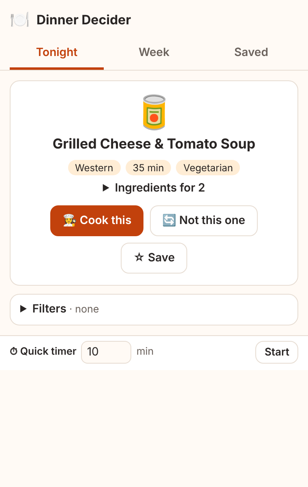
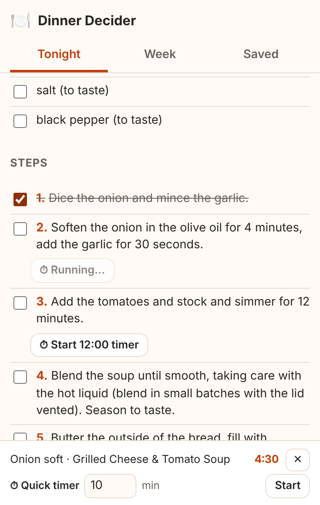
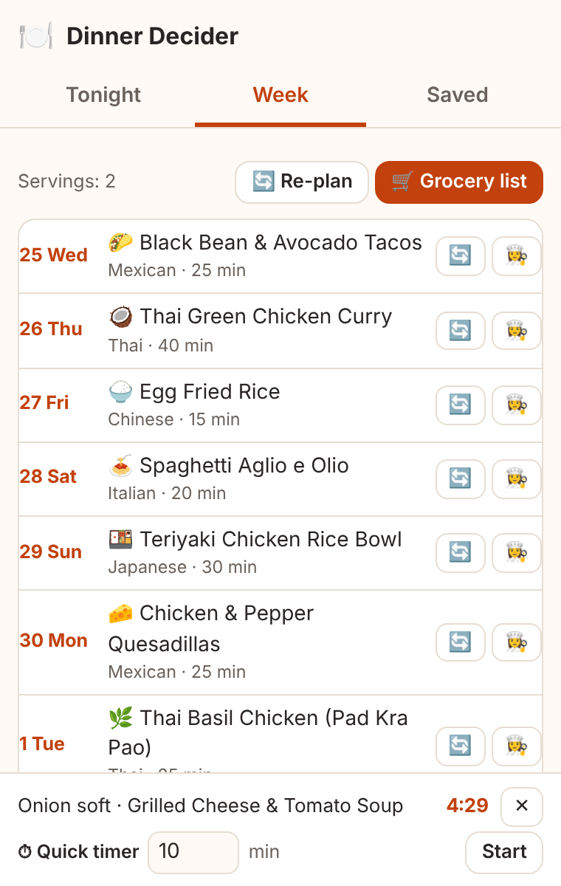

# 🍽️ Dinner Decider

A Chrome/Edge extension that answers "what should I cook tonight?" in one click, then walks you through the recipe with built-in step timers.

  
  
  

## Features

- **One-click dinner pick.** Weighted random choice from 30 dishes: favourites show up more, recently cooked dishes show up less.
- **Filters.** Vegetarian, vegan, no pork, no beef, no fish or shellfish, plus cuisine and maximum cooking time.
- **Cook mode.** Ingredient checklist scaled to your servings, plus step-by-step instructions.
- **Step timers.** Start a timer on any timed step. When it ends you get a notification, a beep, and a green DONE badge on the icon.
- **Week planner.** Plan seven dinners, swap any day, and generate a combined grocery list.
- **Your own meals.** Add custom dishes and save favourites.
- **Private.** Everything is stored locally in your browser. No accounts, no servers, no tracking.

## Install (unpacked)

1. Download this repo: **Code → Download ZIP**, then unzip it.
2. Open `chrome://extensions` (or `edge://extensions`).
3. Turn on **Developer mode**.
4. Click **Load unpacked** and select the unzipped folder.
5. Pin the 🍽️ icon, click it, and press **Test alert** once to confirm notifications work.

On macOS, if no banner appears: System Settings → Notifications → Google Chrome → set to **Alerts**, and turn Focus off.

## Tech

Manifest V3, vanilla JavaScript (no frameworks, no build step), `chrome.storage`, `chrome.alarms`, `chrome.notifications`, and an offscreen document for sound. DOM is built without `innerHTML`.

## Project layout

| File | Purpose |
| --- | --- |
| `manifest.json` | Extension config and permissions |
| `popup.html` / `popup.css` / `popup.js` | The popup UI and logic |
| `data.js` | Dish and recipe data |
| `background.js` | Service worker: timers, alerts, badge |
| `offscreen.html` / `offscreen.js` / `beep.wav` | Plays the timer sound |

## License

MIT. See [LICENSE](LICENSE).
